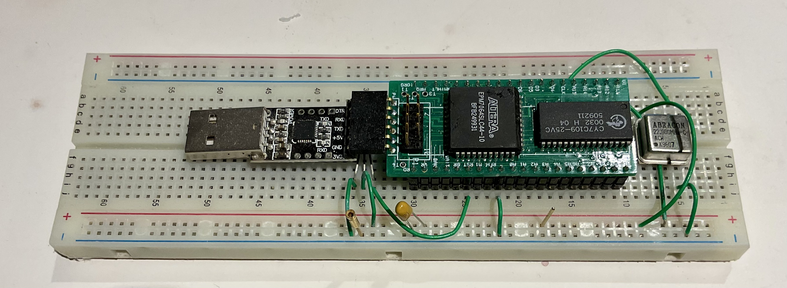

# DiagZ80
Z80 ancillary logic for solderless breadboard.  Create a simple Z80 computer on solderless breadboard to support experimentations.  Design is derived from ZRCC.

### Features
- Ancillary logic plugged over a Z80 on solderless breadboard to form a simple Z80 computer
- 128K RAM
- EPM7064S CPLD
  - ROM for serial bootstrap
  - Hardware serial receiver
  - Bit-bang serial transmitter
  - 4 banks of 32K RAM
  - Page register for ROM
- Based on ZRCC design
- Software compatible with ZRCC
- Require external oscillator and reset supervisor
### Theory of Operation
A small PC board consists of a 128K RAM and CPLD.  The CPLD contains serial bootstrap ROM, serial port, address decode, bank manager for 4 banks of 32K, and page register to swap out ROM.  The two rows of pins are 0.9" apart with same signal assignments as a Z80.  The two rows of pins are designed to straddle over a Z80.  The board works with the Z80 as a simple computer with 128K RAM and enough ROM to boot serially and load/run programs into RAM.  0.9" spacing is enough to bring out wires from solderless breadboard to experiment with other circuits on the breadboard.  The design purpose is to have a pre-built, working computer to assist with testing of circuitries on the breadboard.  An external oscillator and a voltage supervisor is needed to provide system clock and reset signals.  Nominal operating frequency is 22MHz for 115200 baud serial operation.
### Design Files
- [Schematic](diagZ80_r0_scm.pdf)
- [Gerber photoplots](diagz80_r0_gerber.zip)
- Bill of Materials
- [CPLD design](DiagZ80_r0_cpld.zip) files
  - CPLD design in [PDF schematic](diagz80_r0_cpld_scm.pdf)
### Software
DiagZ80 is software compatible with [ZRC](https://github.com/Plasmode/ZRC)
